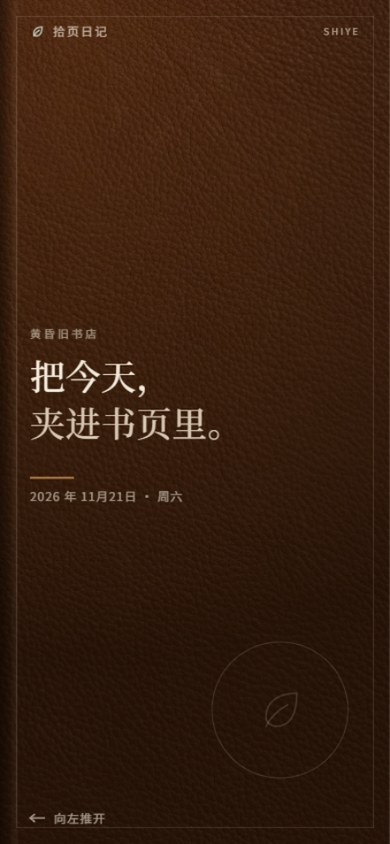
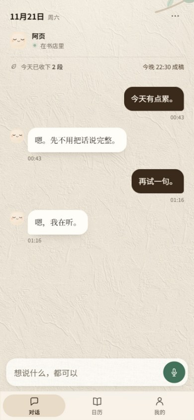
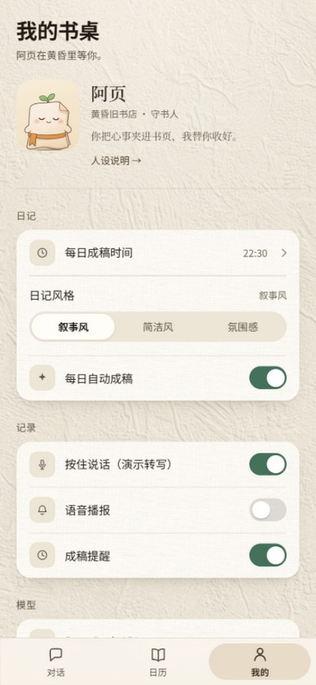
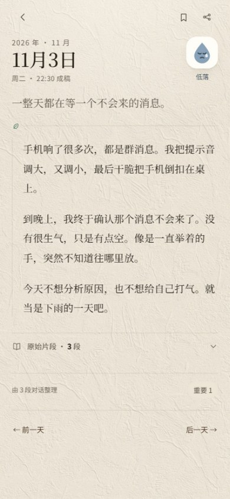
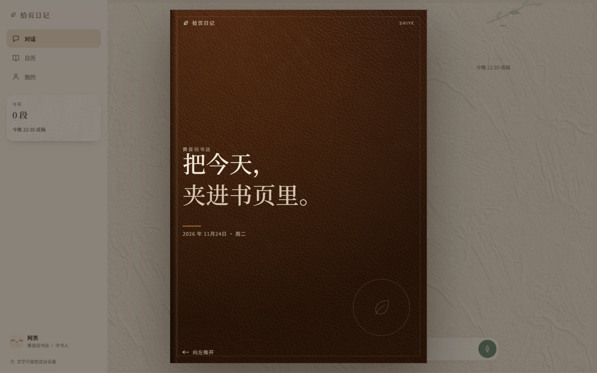
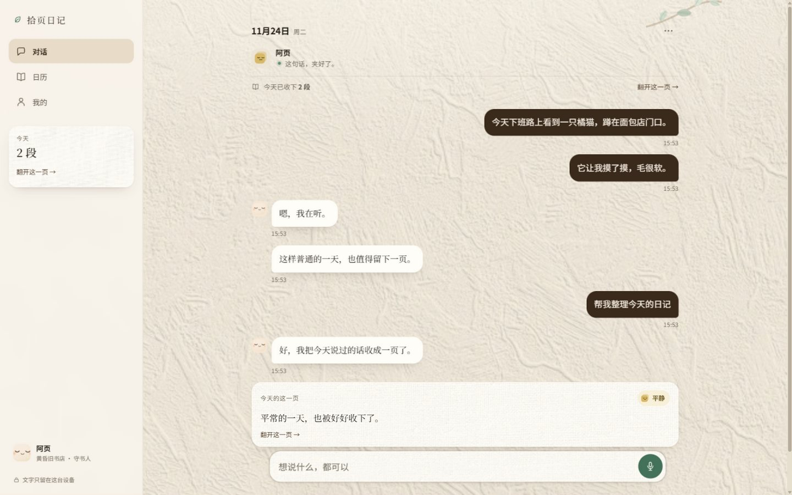

<p align="center">
  
</p>

<h1 align="center">拾页日记</h1>

<p align="center"><b>把今天，夹进书页里。</b><br>AI 叙事陪伴日记 · 手机 + 桌面 Web 高保真 MVP</p>

<p align="center">
  <a href="https://laijliang.github.io/shiye-diary/?demo=1"><b>在线演示（带演示数据）</b></a>
  &nbsp;·&nbsp;
  <a href="https://laijliang.github.io/shiye-diary/">正常入口</a>
  &nbsp;·&nbsp;
  <a href="web/README.md">详细文档</a>
</p>

<p align="center">
  
</p>

| 对话 | 日历 | 我的 |
| :---: | :---: | :---: |
|  |  |  |

<p align="center">
  
</p>

<p align="center">
  
</p>
<p align="center"><sub>桌面上书封是一本 620px 的书，背景压暗；向左拖 / 轻点 / Enter 打开。</sub></p>

<p align="center">
  
</p>
<p align="center"><sub>桌面 ≥900px：左侧导航与今日状态，主区域按阅读宽度居中。</sub></p>

## 桌面上测试

同一个网址在电脑浏览器打开。窗口宽度 **≥900px** 自动切换为桌面布局：

- 左侧是导航 / 今日状态 / 阿页，底部导航收起；
- 主区域按阅读宽度居中：对话 880、日历 1120、我的 980、详情 760；
- 日历变成「月历 + 本月书页」双栏，左栏吸顶、右栏滚动；我的页变成「人设 + 设置」双栏；
- 浮层从底部抽屉变成居中对话框；书封是一本 620px 的书，背景压暗，翻页后进入应用；
- 输入框里按 **Enter 发送**（中文输入法上屏时的 Enter 不算）。

窗口缩到 900px 以下会回到手机布局。

## 手机上测试

1. 手机打开 **https://laijliang.github.io/shiye-diary/?demo=1** —— 会带上 12 篇种子书页和演示入口。
2. 想从空白开始：打开 **https://laijliang.github.io/shiye-diary/**。
3. 加到主屏幕：Chrome / Android 用菜单里的「添加到主屏幕」；iOS Safari 用「分享 → 添加到主屏幕」。已配置 `manifest` 和 192/512/180 图标。

建议路线：向左拖开书封 → 对阿页说「你能做什么」/「帮我整理今天的日记」/「把情绪改成开心」→ 按住麦克风说话 / 上滑取消 → 长按气泡夹书签 → 日历横滑「本月书页」→ 日记详情点分享 → 我的里改成稿时间 / 重演成稿。

## 这是什么

碎片化倾诉 → AI 承接 → 自动成稿 → 情绪日历。用户按住说话，阿页（黄昏旧书店的守书人）以固定人设接住情绪；到设定时间把当天片段整理成一页第一人称日记，落进情绪色日历里。

视觉方向是「旧书店的一盏灯」：页面是灰泥纸纹、卡片是亚麻布纹、封面是皮革；书封用 canvas 做真实卷曲（先卷边、再翻页），有米色封内和落下一页的影子。

## 已实现

- **书封开场**：canvas 柱面卷曲，跟手、可回弹、可中途抓住；轻点 / Enter 也能开。桌面上是一本 620px 的书，背景压暗。
- **对话**：按住说话（浏览器语音识别，失败时演示回退）、暂停自动分段、上滑取消、长按夹书签 / 复制、阿页打字态、情绪镜像头像；可以直接用自然语言让阿页整理/修改今天这一页，改完在聊天里出现可翻开的日记卡；桌面 Enter 发送。
- **日历**：月度情绪色格、原生吸附的横滑书页、情绪筛选、空月份；桌面 ≥900px 变成「月历 + 本月书页」双栏，左栏吸顶、右栏滚动。
- **详情**：第一人称日记、情绪印章、原始片段折叠、收藏、系统分享（Web Share / 复制回退）、前后页；桌面保持 760px 阅读宽度。
- **我的**：成稿时间、日记风格、自动成稿、语音 / 播报 / 提醒、可选 DeepSeek 配置、导出 / 清空；桌面为人设 + 设置双栏。
- **PWA**：可安装到主屏幕；数据全部存在 `localStorage`。
- **导航**：手机是常驻单条底部导航，选中指示条随 tab 滑动；再点当前 tab 回到顶部 / 最新；详情页自动收起。桌面 ≥900px 换成左侧导航，带 hover 与键盘焦点。

## 技术说明

- 纯静态：原生 HTML / CSS / JS，无构建、无框架、无外部依赖。
- 响应式：<520px 全宽手机布局；520–899px 居中的 430px 书页列；≥900px 桌面布局（260px 侧栏 + 阅读宽度 + 双栏日历/我的）。
- 数据只存在浏览器 `localStorage`（键 `shiye.v1`），不经过任何服务器。
- 默认 AI 回复是本地演示；在「我的 → 模型」里显式填写自己的模型服务后，浏览器才会请求该地址（含日记动作）。语音使用浏览器语音识别（不支持的浏览器回退演示文本）；定时成稿仍是前端模拟。
- 部署：GitHub Pages（GitHub Actions 发布 `web/`）。

## 目录

```
.
├── web/                      # 应用（index.html / css / js / assets / manifest.json）
├── DESIGN.md                 # 改 UI 前必读的硬规则与理由
├── ayeh-mascot-brief.md      # 阿页角色生成需求（已按此生成并接入）
├── .github/workflows/pages.yml
└── docs/screenshots/         # README 截图
```

## 本地运行

```bash
cd web
python serve.py
# http://127.0.0.1:4173/
# 演示数据：http://127.0.0.1:4173/?demo=1
```

## 设计

- 硬规则、动效曲线、材质与交互判据见 [DESIGN.md](DESIGN.md)（含桌面 ≥900px 的布局规则）。
- 设计工程方法来自 [emilkowalski/skills](https://github.com/emilkowalski/skills)（`emil-design-eng` / `apple-design` / `mobile-native` / `choreograph` / `learn-taste`）。
- 阿页是外部生成的五表情位图（`web/assets/ayeh-*.webp`），28px 以下自动使用 `*-face.webp` 头像裁切；角色需求见 [ayeh-mascot-brief.md](ayeh-mascot-brief.md)。

## 边界

- 默认 AI 回复与定时成稿仍是前端模拟；语音使用浏览器识别；真实定时任务、长图导出、自定义人设、多端同步、暗色模式未实现。
- 没有 Service Worker：安装到主屏幕后，首次打开仍需联网加载静态文件。
- 分享使用系统分享面板，桌面端或旧浏览器回退为复制文本。
